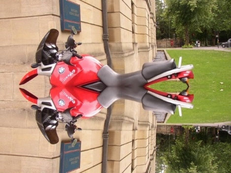
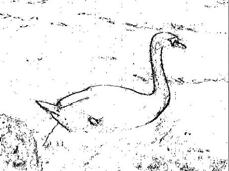
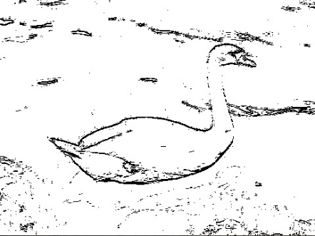
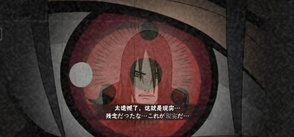
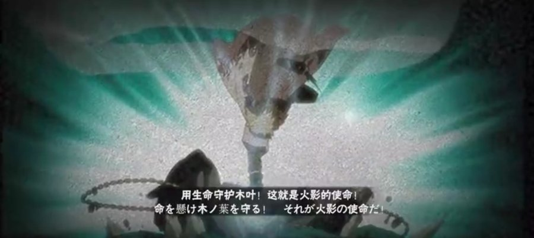
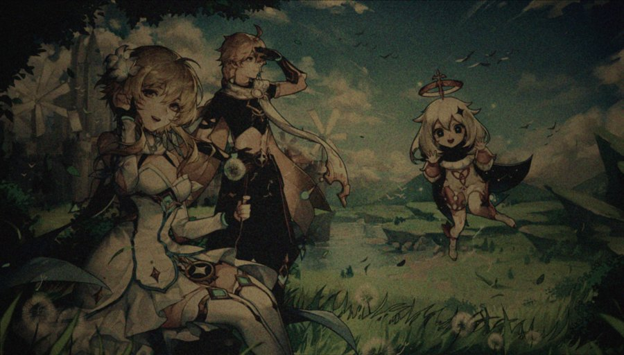
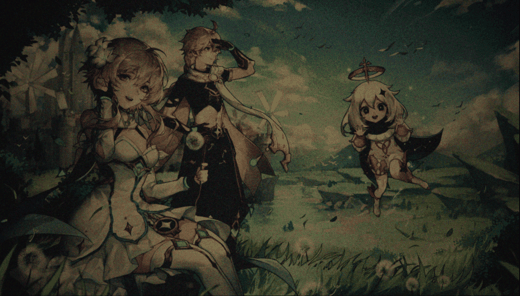

[English](README.md) | **简体中文**

# 图像处理与滤镜

这是我 2023 年高中编程课的期末大作业，使用了 Python、NumPy、Pillow 和 OpenCV。

## 1. 图片镜像
镜像是把图片分成两半，再将一半复制到另一半。从右向左镜像时，把 `img[row, col]` 和 `img[row, img_width-1-col]` 反过来赋值；从上向下镜像时，把宽换成高、列换成行即可。



## 2. 边缘检测
对比相邻的两个像素，用下面的公式计算颜色差异：

`diff = sqrt((B2-B1)^2 + (G2-G1)^2 + (R2-R1)^2)`

差异超过阈值就标黑，表示边缘，其余为白色。测试时上下比较取 20，左右比较取 13。左右比较更容易发现竖直边缘，上下比较更容易发现水平边缘。

| 左右比较 | 上下比较 |
| --- | --- |
|  |  |

## 3. 图片滤镜
玩火影忍者手游时，我觉得里面的奥义图特别好看，就想用 Python 做一个类似的效果。它的特点是：越靠边缘越暗（晕影），有噪点，还有一点模糊。

| 灵感 | 灵感 |
| --- | --- |
|  |  |

制作过程：
1. **调色**：降低亮度和饱和度、提高对比度，再分别调整 R、G、B 三个通道。
2. **噪点**：用 `np.random.normal` 生成高斯噪声。网上的代码运行时报错，我改成把图片和噪声都转为数组相加，再把像素值限制在 0–255 之间。
3. **晕影**：用 Pillow 的 `composite`，以白色椭圆作为 mask，把原图贴到黑色底板上；mask 再加高斯模糊，让边缘过渡自然。
4. **抖动**：网上没找到做法，这部分让 ChatGPT 帮我写，生成随机偏移的帧并导出 GIF。

| 原图 | 效果 |
| --- | --- |
|  |  |

抖动效果：



*灵感截图来自火影忍者手游，演示原图来自原神（© HoYoverse），仅用于非商业展示。*

## 运行方法
```bash
pip install numpy pillow opencv-python
python filters.py   # 在同一文件夹放一张名为 test.jpg 的图片
```

## 总结
**收获：** 花了很多时间查资料，学会了安装各种库，以及 Pillow 的一些基本用法和滤镜效果。

**现在会改进的地方：**
- 一次同时检测两个方向的边缘
- 用 NumPy 向量化运算代替逐像素循环，提高速度
